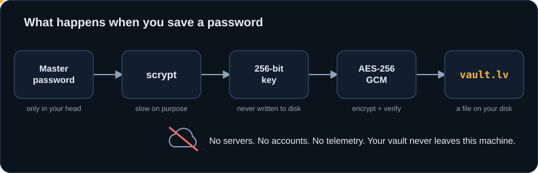

<div dir="rtl" align="right">

<div align="center">



**یک پسورد منیجر شبیه Bitwarden که کاملاً روی کامپیوتر خودت می‌ماند.**
بدون حساب کاربری، بدون سرور، بدون ابر. فقط یک فایل رمزنگاری‌شده که فقط با مستر پسورد باز می‌شود.

[English](README.md)

</div>

---

## قابلیت‌ها

- **خزانه‌ی رمزنگاری‌شده:** AES-256-GCM با کلیدی که از مستر پسورد با scrypt ساخته می‌شود. ذخیره‌سازی اتمیک است و یک نسخه‌ی `.bak` نگه داشته می‌شود.
- **لاگین و یادداشت امن:** نام کاربری، پسورد، آدرس سایت، یادداشت، پوشه، علاقه‌مندی و جستجوی فوری.
- **پسورد جنریتور:** پسورد تصادفی (طول، نوع کاراکتر، حذف کاراکترهای شبیه هم) و پسفرِیز، با نوار قدرت زنده.
- **احراز هویت دومرحله‌ای داخلی (TOTP):** کلید TOTP را کنار لاگین ذخیره کن و کد ۶ رقمی زنده را با شمارش معکوس ببین.
- **ممیزی امنیتی:** پسوردهای ضعیف، تکراری و قدیمی و لاگین‌های بدون 2FA را پیدا می‌کند. بررسی نشت اطلاعات (اختیاری و آنلاین) فقط ۵ کاراکتر اول هش را می‌فرستد.
- **قفل خودکار و پاک‌شدن کلیپ‌بورد:** بعد از بی‌کاری قفل می‌شود و پسوردهای کپی‌شده بعد از چند ثانیه از کلیپ‌بورد پاک می‌شوند.
- **تاریخچه‌ی پسورد:** با هر تغییر، پسورد قبلی نگه داشته می‌شود.
- **ایمپورت و اکسپورت:** فایل CSV برنامه‌های Bitwarden، Chrome، Edge و Firefox را می‌خواند. خروجی CSV یا بکاپ رمزنگاری‌شده می‌دهد.
- **تم تیره و روشن** و ویندوز و لینوکس.

<div align="center">

</div>

## نصب

به **Python نسخه‌ی ۳.۹ یا بالاتر** نیاز داری. بقیه‌ی چیزها را نصب‌کننده در یک محیط مجازی جدا می‌گذارد و LocalVault را به منوی برنامه‌ها اضافه می‌کند.

<div align="center">

</div>

</div>

### لینوکس

```bash
git clone https://github.com/ERROR404DTIR/LocalVault.git
cd LocalVault
bash install.sh
```

### ویندوز

```powershell
git clone https://github.com/ERROR404DTIR/LocalVault.git
cd LocalVault
.\install.bat
```

<div dir="rtl" align="right">

روی ویندوز می‌توانی روی `install.bat` دوباره کلیک کنی. شورتکات روی دسکتاپ و منوی استارت ساخته می‌شود. اگر Python نصب نباشد، پیشنهاد نصب با `winget` می‌دهد. روی لینوکس هم اگر Tk نباشد، با مدیر بسته‌ی سیستمت (apt، dnf، pacman و غیره) نصبش را پیشنهاد می‌دهد.

### نصب با pipx

</div>

```bash
pipx install git+https://github.com/ERROR404DTIR/LocalVault.git
localvault
```

<div dir="rtl" align="right">

### حذف

</div>

```bash
bash install.sh --uninstall            # لینوکس (خزانه می‌ماند)
bash install.sh --uninstall --purge    # لینوکس (خزانه هم پاک می‌شود)
```

```powershell
.\install.ps1 -Uninstall            # ویندوز (خزانه می‌ماند)
.\install.ps1 -Uninstall -Purge     # ویندوز (خزانه هم پاک می‌شود)
```

<div dir="rtl" align="right">

## مدل امنیتی

<div align="center">

</div>

- مستر پسورد با **scrypt** و salt تصادفی به کلید تبدیل می‌شود.
- خزانه با **AES-256-GCM** رمزنگاری و احراز می‌شود. پسورد اشتباه یا فایل دست‌کاری‌شده اصلاً باز نمی‌شود.
- کلید فقط تا وقتی خزانه باز است در حافظه می‌ماند.
- پسوردها با ماژول `secrets` (تولید تصادفی امن سیستم‌عامل) ساخته می‌شوند.
- تنها قابلیت اینترنتی، بررسی نشت اطلاعات است که فقط با فشردن دکمه اجرا می‌شود.

**محدودیت‌ها را بدان:** بازیابی مستر پسورد **وجود ندارد**؛ اگر فراموشش کنی داده‌ها از بین می‌روند. اگر روی سیستمت بدافزار باشد یا کسی به سشن بازت دسترسی داشته باشد، می‌تواند هرچه تو می‌بینی ببیند. این پروژه توسط شخص ثالث ممیزی امنیتی نشده است، پس بکاپ بگیر.

## لایسنس

[MIT](LICENSE)

</div>
