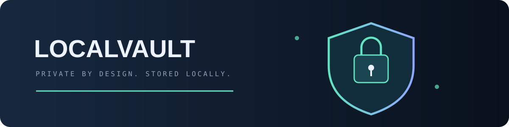
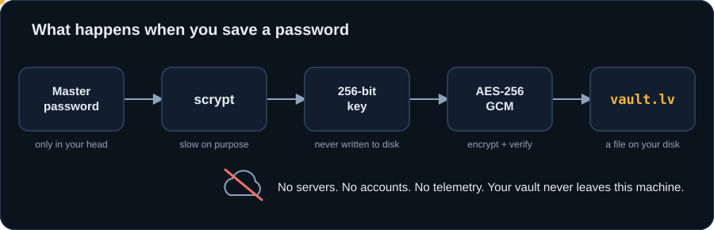

<div align="center">

<p align="center"></p>



**A Bitwarden-style password manager that lives entirely on your computer.**
No account, no server, no cloud. One encrypted file that only your master password can open.

[فارسی](README.fa.md) · [Install](#install) · [Features](#features) · [Security model](#security-model)

</div>

---

## Features

| | |
|---|---|
| **Encrypted vault** | AES-256-GCM with a key derived by scrypt. Saves are atomic and a `.bak` copy is kept. |
| **Logins and secure notes** | Username, password, website, notes, folders, favorites, instant search. |
| **Password generator** | Random passwords (length, character sets, no look-alikes) and passphrases, with a live strength meter. |
| **Built-in authenticator** | Store a TOTP secret next to the login and get the live 6-digit code with a countdown. |
| **Security audit** | Finds weak, reused and old passwords and logins without 2FA. Optional breach check using the k-anonymity API (only a 5-character hash prefix is sent). |
| **Auto-lock and clipboard clearing** | Locks after inactivity (or on minimize). Copied passwords are wiped from the clipboard after a delay. |
| **Password history** | Every change keeps the previous password so a bad update is never fatal. |
| **Import and export** | Reads Bitwarden, Chrome, Edge and Firefox CSV exports. Exports CSV or an encrypted backup. |
| **Dark and light themes** | Plus a modern interface built with CustomTkinter. |
| **Windows and Linux** | Simple installers for both. |

<div align="center">

</div>

## Install

You need **Python 3.9 or newer**. The installer sets up everything else in its own virtual environment and adds LocalVault to your app menu.

<div align="center">

</div>

### Linux

```bash
git clone https://github.com/ERROR404DTIR/LocalVault.git
cd LocalVault
bash install.sh
```

If Tk is missing, the script offers to install it with your package manager (apt, dnf, pacman, zypper or apk). Then start **LocalVault** from your app menu or run `localvault`.

### Windows

```powershell
git clone https://github.com/ERROR404DTIR/LocalVault.git
cd LocalVault
.\install.bat
```

You can also just double-click `install.bat`. It creates Desktop and Start Menu shortcuts. If Python is missing it offers to install it with `winget`.

### With pipx (any OS)

```bash
pipx install git+https://github.com/ERROR404DTIR/LocalVault.git
localvault
```

### Run without installing

```bash
pip install -r requirements.txt
python -m localvault
```

### Update and uninstall

Run the installer again to update. To remove the app:

```bash
bash install.sh --uninstall            # Linux (keeps your vault)
bash install.sh --uninstall --purge    # Linux (also deletes your vault)
```

```powershell
.\install.ps1 -Uninstall            # Windows (keeps your vault)
.\install.ps1 -Uninstall -Purge     # Windows (also deletes your vault)
```

## Using it

1. **First launch:** choose a master password. Make it long. A few random words work well, and the built-in passphrase generator can make one.
2. **Add items** with **+ New**. Press **Generate** inside the form to fill a strong password.
3. **Copy, don't type.** Copy buttons clear the clipboard automatically (20 seconds by default).
4. **Check the Security audit** page now and then.
5. **Back up** from Settings with *Encrypted backup*. The backup is safe to keep anywhere.

Use a custom vault location (for example a synced folder or a USB stick):

```bash
localvault --vault /path/to/my-vault.lv
```

Default locations: `~/.local/share/localvault/vault.lv` (Linux) and `%APPDATA%\LocalVault\vault.lv` (Windows). Set `LOCALVAULT_HOME` to change the folder.

## Security model

<div align="center">

</div>

- Your master password is stretched with **scrypt** (N=2^15, r=8, p=1, random 16-byte salt). The parameters are stored in the file header and are authenticated.
- The vault is encrypted and authenticated with **AES-256-GCM** and a fresh random nonce on every save. A wrong password or a modified file fails to open; nothing is ever half-decrypted.
- The derived key exists only in memory while the vault is unlocked. Locking drops it.
- Passwords are generated with Python's `secrets` module (the operating system's CSPRNG).
- The only network feature is the optional breach check. It runs only when you press the button and sends just the first 5 characters of a SHA-1 hash.

**Be aware of the limits.** There is **no password recovery**: forget the master password and the data is gone. Anyone with malware or physical access to your unlocked session can read what you can read. Python cannot reliably wipe secrets from memory. LocalVault has not been independently audited, so treat it as a careful personal project and keep backups.

<div align="center">

</div>

## Moving from another manager

Export a CSV from Bitwarden, Chrome, Edge or Firefox, then use **Settings > Import CSV**. Duplicates are skipped. Delete the CSV afterwards, since it holds your passwords in plain text.

## Project layout

```
localvault/
  crypto.py        scrypt + AES-256-GCM
  vault.py         entries, folders, atomic encrypted storage
  generator.py     passwords, passphrases, strength estimate
  totp.py          RFC 6238 one-time codes
  audit.py         weak / reused / old / breach checks
  importexport.py  CSV import and export, encrypted backup
  gui/             CustomTkinter interface
tests/             unit tests and a GUI smoke test
```

## Development

```bash
python -m venv .venv && source .venv/bin/activate   # Windows: .venv\Scripts\activate
pip install -e ".[dev]"
pytest                                               # use xvfb-run pytest on a headless Linux box
```

Pull requests are welcome.

## License

[MIT](LICENSE)